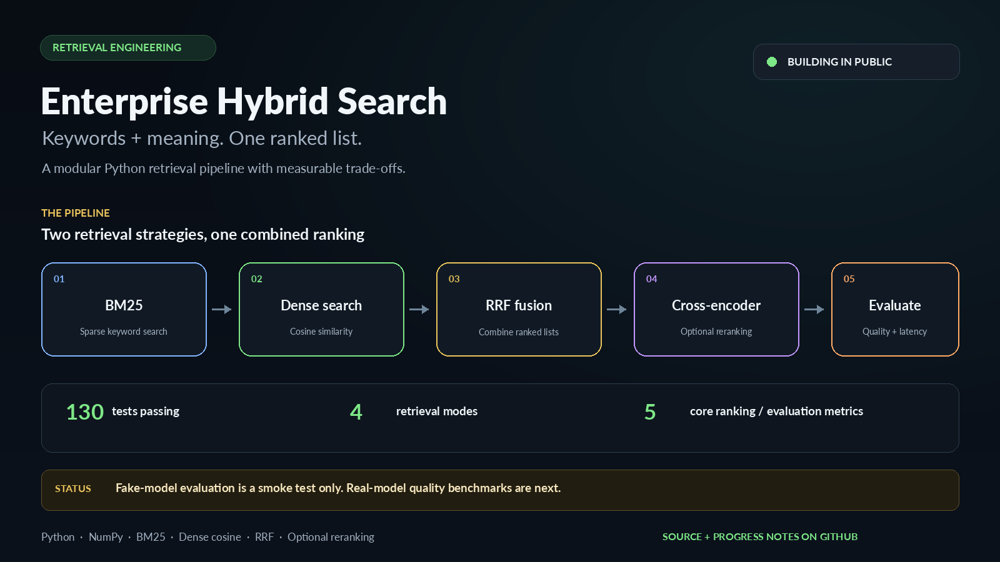

# Enterprise Hybrid Search

**A practical Python project for combining keyword search, semantic search, and reranking.**

Enterprise Hybrid Search explores a common retrieval problem: keyword search is good at finding exact terms, IDs, and error codes, while dense retrieval can find related meaning even when the wording differs. This project runs both retrievers, combines their rankings with Reciprocal Rank Fusion (RRF), and can optionally rerank the candidates with a cross-encoder.

> **Current status:** the Python retrieval pipeline and evaluation CLI are implemented, and the test suite passes locally (130 tests). The offline fake-model evaluation is only a smoke test—not evidence of real retrieval quality. Real-model benchmark results, a hosted search API, and a full web UI are not yet verified or included.

<p align="center">
  
</p>

## What it includes

- **Text chunking:** word-window chunks with configurable size and overlap.
- **BM25 sparse search:** exact token matching with Lucene-style IDF, term-frequency saturation, and document-length normalisation.
- **Dense search:** exact cosine-similarity search with NumPy; the embedding function is injected, so tests do not need a model download.
- **Hybrid ranking:** Reciprocal Rank Fusion (RRF) combines sparse and dense rankings without adding scores from different scales directly.
- **Optional reranking:** a cross-encoder scores a smaller set of fused candidates.
- **Evaluation:** Precision@K, Recall@K, MRR, nDCG@K, and p50/p95 latency, with separate document-level and chunk-level evaluation paths.
- **Input validation:** checks for corpus/query schemas, duplicate IDs, invalid parameters, unexpected model output shapes, and non-finite scores.
- **Automated tests:** unit, edge-case, and end-to-end tests; GitHub Actions CI is configured.

## Retrieval flow

```text
JSONL documents
      |
      v
 word-window chunking
      |
      +----------------------------+
      |                            |
      v                            v
 BM25 sparse search        Dense cosine search
      |                            |
      +-------------+--------------+
                    |
                    v
           RRF rank fusion
                    |
                    v
       Optional cross-encoder rerank
                    |
                    v
          Ranked chunk results
                    |
                    v
      Evaluation: P@K, R@K, MRR,
             nDCG@K, p50/p95
```

Read more: [Architecture](docs/ARCHITECTURE.md) · [Engineering decisions](docs/DECISIONS.md) · [Project overview page](https://Leonidus786.github.io/enterprise-hybrid-search/). Before publishing, replace `Leonidus786` with your GitHub username in the README and site files.

## Quick start

Python 3.10 or newer is required. The commands below use [`uv`](https://docs.astral.sh/uv/) and work from the project root.

### 1. Install the project and development dependencies

```bash
uv sync --extra dev
```

### 2. Run the tests

```bash
uv run python -m pytest -q
```

The current local baseline is **130 passing tests**. Runtime depends on the machine and environment.

### 3. Run the offline evaluation smoke test

```bash
uv run python scripts/run_eval.py --fake
```

This runs the BM25, dense, hybrid, and hybrid-plus-reranking paths using deterministic fake functions. It is useful for checking that the pipeline and metrics execute end to end. **Do not use these fake-model scores to claim retrieval quality or compare real models.**

### 4. Run with real embedding and reranking models

Install the optional model dependencies:

```bash
uv sync --extra models --extra dev
```

Then run:

```bash
uv run python scripts/run_eval.py
```

The first real-model run downloads the configured Sentence Transformers models and may take time and disk space. By default, the script uses:

- Embeddings: `BAAI/bge-small-en-v1.5`
- Reranker: `cross-encoder/ms-marco-MiniLM-L-6-v2`

Real-model results have **not been validated for this release**. Review the data and relevance labels before treating the output as a benchmark. For CPU/GPU memory constraints, see the [Sentence Transformers documentation](https://www.sbert.net/).

### Install with pip instead

```bash
python -m pip install -e ".[dev]"
python -m pytest -q
python scripts/run_eval.py --fake
```

For real-model evaluation, install the model extra too:

```bash
python -m pip install -e ".[models,dev]"
python scripts/run_eval.py
```

## Evaluation data

The repository includes a small example corpus of **14 documents** at `data/corpus.jsonl` and **10 labeled queries** at `data/queries.json`. This is a learning/evaluation starter set, not a representative enterprise dataset.

With the default `--k 10`, the printed report includes **Recall@10** (shown as `recall@10`), Precision@10, MRR, nDCG@10, and p50/p95 latency. These are metric names, not a published real-model result.

Each corpus JSONL row has this shape:

```json
{ "doc_id": "example_doc", "text": "Text to index goes here." }
```

Each query entry has this shape:

```json
{
  "id": "q1",
  "query": "How do I find the relevant passage?",
  "relevant": ["example_doc"]
}
```

The `relevant` values are document IDs for document-level evaluation. Use chunk IDs only with the chunk-level protocol. The data is a small starter set, not a representative enterprise benchmark. For meaningful claims, build a representative corpus, label relevant results, and report the real-model results with the model names, settings, dataset, and latency environment.

### Useful CLI options

```bash
# Change the evaluation cutoff
uv run python scripts/run_eval.py --k 5 --fake

# Change how many fused chunks are passed to the reranker
uv run python scripts/run_eval.py --candidate-k 100 --fake

# Evaluate chunk IDs rather than unique parent documents
uv run python scripts/run_eval.py --level chunk --fake

# Use real models but disable the BGE query-side instruction
uv run python scripts/run_eval.py --no-bge-prefix
```

The `--fake` flag is for pipeline smoke tests only. The `--no-bge-prefix` option applies to real-model runs; it is not a claim that one prefix setting is universally better.

## Design notes

- **Why RRF?** BM25 scores and cosine similarities live on different scales. RRF combines rank positions without requiring score calibration.
- **Why exact cosine search?** It keeps the implementation small and straightforward to test. Very large corpora may need an approximate nearest-neighbour index or vector database.
- **Why inject models?** Tests stay fast and offline, and embedding/reranking implementations can be swapped without rewriting retrieval logic.
- **Why separate document-level and chunk-level evaluation?** Ranking chunks and then deduplicating can allow many chunks from one document to crowd other documents out. The evaluation code keeps these protocols separate.

These are engineering choices, not claims that the current defaults are optimal. See [DECISIONS.md](docs/DECISIONS.md) for trade-offs and experiments still to run.

## Current limitations

- No hosted API, authentication, persistent vector database, or complete browser search UI is included yet.
- Ingestion currently reads JSONL documents and chunks their text. It does **not** currently provide direct PDF/TXT upload UI.
- The example corpus and labels are small and should not be treated as an enterprise benchmark.
- Fake-model scores are not evidence of real retrieval quality.
- Exact dense search scans all stored vectors; large-corpus deployment will require performance testing and may need ANN/vector-database support.
- A `LICENSE` file has not been added yet. Until a license is chosen and included, do not assume others have permission to reuse or redistribute the code.

## Roadmap

1. Run and document real-model benchmarks on a more representative, labeled corpus.
2. Study candidate-pool size versus reranking latency and retrieval quality.
3. Add a small API and user-facing search demo.
4. Add document ingestion, persistence, deployment, and access controls only after the retrieval baseline is measured.

## Project links

- [Architecture](docs/ARCHITECTURE.md)
- [Engineering decisions](docs/DECISIONS.md)
- [Static project page and toy RRF explainer](docs/index.html)
- [Social launch copy](docs/SOCIAL_POSTS.md)

If you try the project, feedback on evaluation design, fusion, or reranking is welcome. The next update will focus on real-model measurements rather than unverified performance claims.
