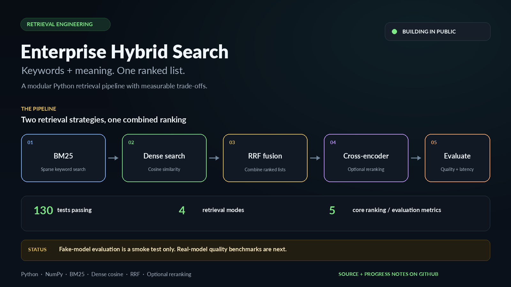

# Enterprise Hybrid Search

A reproducible Python retrieval-engineering project that combines **BM25 keyword search**, **dense semantic retrieval**, and **Reciprocal Rank Fusion (RRF)**, with an optional **Cross-Encoder reranking** stage.

The project focuses on making retrieval behavior measurable: deterministic evaluation workflows, model-revision provenance, per-query ranking traces, latency measurements, and regression tests. It is currently a **retrieval and evaluation toolkit prototype**—not a hosted enterprise search product or a production RAG platform.

<p align="center">
  
</p>

## Project status

- **Retrieval:** BM25 sparse retrieval, exact Dense cosine search, Reciprocal Rank Fusion (RRF), and optional Cross-Encoder reranking are implemented.
- **Ingestion:** JSONL document loading, optional source/title/metadata fields, revision-aware embedding caching, deterministic document/chunk identities, and duplicate document-ID validation are implemented.
- **Persistent indexing:** Immutable, versioned snapshots are implemented using `documents.jsonl`, `chunks.jsonl`, `vectors.npy`, and a validated manifest with artifact checksums.
- **Snapshot lifecycle:** Snapshot loading, persisted DenseIndex initialization, HybridPipeline reconstruction, atomic activation, and explicit rollback are implemented and tested.
- **Full rebuild:** Deterministic full-corpus rebuilding is implemented. Documents are sorted by `doc_id`, chunks are regenerated, and the new snapshot is activated only after validation.
- **Incremental lifecycle:** Document insert, update, delete, idempotency, automated recovery, and snapshot-retention policies remain in progress.
- **Evaluation:** Document-level and chunk-level evaluation, per-query traces, provenance metadata, statistical comparison, and latency tooling are implemented.
- **Tests:** **536 tests passed** in the local Windows test run on 5 November 2026 (`6.21s`). This is local regression evidence, not a claim about an external CI run.
- **Benchmark:** A pinned-model SciFact document-level evaluation has been run on 300 queries. Results and limitations are documented below.
- **Product surface:** Hosted API, grounded RAG answer generation, authentication, multi-tenant access control, and a complete interviewer-facing demo are not yet implemented.

## What the project includes

- **BM25 sparse retrieval:** Token-based retrieval with Lucene-style inverse document frequency, term-frequency saturation, and document-length normalisation.
- **Dense retrieval:** Exact cosine-similarity search using NumPy and injected embedding functions.
- **Hybrid retrieval:** Reciprocal Rank Fusion combines sparse and dense rank positions without directly adding scores from different scales.
- **Optional reranking:** A Sentence Transformers Cross-Encoder can rescore a bounded candidate pool.
- **Chunking:** Word-window chunking with configurable size and overlap, plus a no-chunk document-level mode.
- **Metadata-aware ingestion:** JSONL documents with document IDs and text, plus optional source, title, and metadata fields.
- **Deterministic identity:** SHA-256 document and chunk revision identities, with explicit duplicate document-ID rejection.
- **Embedding cache:** Persistent per-text NumPy vectors with revision-aware cache identity, configuration-aware isolation, corruption checks, and atomic file replacement.
- **Persistent searchable index:** Immutable versioned snapshots containing document records, chunk records, normalized dense vectors, and a versioned manifest.
- **Index integrity:** Artifact checksums, manifest validation, embedding identity checks, vector validation, and corpus fingerprints.
- **Atomic activation:** Validated snapshots are promoted to immutable versions and published through an atomic `CURRENT.json` pointer. Explicit rollback to retained versions is supported.
- **Deterministic rebuild:** Full-corpus rebuild API with canonical document ordering and regenerated chunks and vectors.
- **Evaluation:** Precision@K, Recall@K, MRR, nDCG@K, candidate recall, per-query traces, and latency reporting.
- **Provenance:** Corpus/query fingerprints, model revision metadata, runtime information, and Git state in saved evaluation artifacts.
- **Tests:** Unit, edge-case, regression, and end-to-end tests.

## Retrieval flow

```text
                         JSONL corpus
                              |
                              v
                       Text chunking
                              |
                  +-----------+-----------+
                  |                       |
                  v                       v
             BM25 sparse              Dense cosine
              retrieval                retrieval
                  |                       |
                  +-----------+-----------+
                              |
                              v
                       RRF rank fusion
                              |
                              v
                  Optional Cross-Encoder
                         reranking
                              |
                              v
                        Ranked results
                              |
                              v
               Evaluation and per-query traces
```

The Cross-Encoder is an optional ranking stage. The current SciFact experiments did **not** show a ranking-metric improvement over hybrid retrieval, and CPU inference was substantially more expensive. Run it deliberately and measure it on the target corpus before adopting it.

## Persistent index architecture

The persistent index uses immutable, versioned snapshots.

```text
index_root/
├── CURRENT.json
├── staging/
└── versions/
    └── <index_id>/
        ├── manifest.json
        ├── documents.jsonl
        ├── chunks.jsonl
        └── vectors.npy
```

- `documents.jsonl` stores validated source documents and their supported metadata.
- `chunks.jsonl` stores deterministic chunk records and revision identities.
- `vectors.npy` stores the normalized `float32` embedding matrix, aligned by chunk order.
- `manifest.json` records corpus fingerprints, embedding identity, chunking configuration, sparse configuration, vector dimensions, and artifact checksums.
- `CURRENT.json` identifies the active immutable snapshot and records the previous version information used by rollback.

The loader validates the manifest, artifact checksums, record counts, corpus identity, and vector matrix before exposing a snapshot.

A persisted `HybridPipeline` reconstructs BM25 from stored chunks and initializes DenseIndex from the precomputed vectors. Loading an existing snapshot does not require re-embedding its documents.

Full deterministic rebuild is currently supported through `rebuild_and_activate_index_snapshot()`. Incremental insert, update, delete, idempotency, and automated snapshot-retention policies are still under development.

Activation currently assumes a single writer. Cross-process writer locking is not implemented.

## Quick start

### Requirements

- Python 3.10 or newer
- [`uv`](https://docs.astral.sh/uv/)
- Optional: the model dependencies and sufficient RAM/disk space for Sentence Transformers models

### 1. Install development dependencies

```bash
uv sync --extra dev
```

For real embedding and Cross-Encoder evaluation, install the model extra too:

```bash
uv sync --extra models --extra dev
```

### 2. Run the test suite

```bash
uv run python -m pytest -q
```

Latest recorded local result:

```text
536 passed in 6.21s
```

This result was recorded on 5 November 2026 in the local Windows environment. Test counts and runtime can change as the repository evolves and depend on the local environment.

### 3. Run an offline smoke test

```bash
uv run python scripts/run_eval.py --fake
```

The fake embedding and scoring functions allow the retrieval and evaluation flow to run without downloading models. Fake-model metrics are **smoke-test output only**: do not use them as evidence of retrieval quality or as a comparison between real retrieval models.

### 4. Run a real-model evaluation

```bash
uv run python scripts/run_eval.py
```

The first run may download the configured models. With no `--strategies` argument, the current CLI evaluates all four strategies (`bm25`, `dense`, `hybrid`, and `hybrid_rerank`). To exclude the reranked strategy from the evaluation, pass an explicit strategy list such as `--strategies bm25 dense hybrid`. The current real-model runner still initializes the Cross-Encoder adapter before evaluation even when that strategy is excluded; lazy loading it only when requested is a remaining implementation improvement.

The current model defaults are:

| Component     | Model                                  | Pinned revision in the recorded SciFact run |
| ------------- | -------------------------------------- | ------------------------------------------- |
| Embeddings    | `BAAI/bge-small-en-v1.5`               | `5c38ec7c405ec4b44b94cc5a9bb96e735b38267a`  |
| Cross-Encoder | `cross-encoder/ms-marco-MiniLM-L-6-v2` | `233902d25c440f23af6f7d6e94d2946bac0bee0a`  |

The CLI supports explicit model revisions. See the evaluation examples below for a reproducible command shape.

## Input data format

The current corpus loader reads JSONL. Each line represents one document. The required fields are `doc_id` and `text`; `source`, `title`, and `metadata` are optional.

```json
{
  "doc_id": "example_doc",
  "text": "Text to index goes here.",
  "source": "internal-handbook",
  "title": "Example document",
  "metadata": {
    "department": "engineering"
  }
}
```

The query file is a JSON array. Each query has an ID, query text, and relevant document IDs:

```json
[
  {
    "id": "q1",
    "query": "How do I find the relevant passage?",
    "relevant": ["example_doc"]
  }
]
```

For document-level evaluation, `relevant` contains parent document IDs. For chunk-level evaluation, use the chunk-ID space expected by the chunk-level protocol. The bundled `data/sample/` corpus and labels are a small starter dataset, not a representative enterprise benchmark.

## Useful evaluation commands

### Offline smoke test

```bash
uv run python scripts/run_eval.py --fake
```

### Compare retrieval without reranking

```bash
uv run python scripts/run_eval.py --strategies bm25 dense hybrid
```

### Explicitly evaluate hybrid retrieval and reranking

```bash
uv run python scripts/run_eval.py --strategies hybrid hybrid_rerank --candidate-k 10
```

### Evaluate chunk IDs instead of parent document IDs

```bash
uv run python scripts/run_eval.py --level chunk
```

### Evaluate each document as one searchable item

```bash
uv run python scripts/run_eval.py --no-chunk --level doc
```

### Pin model revisions and save a result artifact

```cmd
uv run python scripts/run_eval.py ^
  --corpus data/scifact_test/corpus.jsonl ^
  --queries data/scifact_test/queries.json ^
  --k 10 ^
  --retrieval-k 100 ^
  --candidate-k 50 ^
  --level doc ^
  --no-chunk ^
  --embedding-revision 5c38ec7c405ec4b44b94cc5a9bb96e735b38267a ^
  --reranker-revision 233902d25c440f23af6f7d6e94d2946bac0bee0a ^
  --output results/scifact_doclevel_pinned_v2.json
```

The line-continuation character `^` in this example is for Windows CMD. On shells that use a different continuation syntax, put the command on one line or adjust the separators.

### Cross-Encoder inference options

The evaluation CLI supports the following Cross-Encoder settings. The options affect the reranking implementation when `hybrid_rerank` is evaluated:

| Option                  | Purpose                                            | Current default        |
| ----------------------- | -------------------------------------------------- | ---------------------- |
| `--reranker-batch-size` | Number of query/document pairs per inference batch | `8`                    |
| `--reranker-device`     | Explicit inference device, such as `cpu` or `cuda` | automatic (`None`)     |
| `--reranker-max-length` | Override the model's maximum input length          | model setting (`None`) |

Example for a CPU run:

```bash
uv run python scripts/run_eval.py --strategies hybrid hybrid_rerank --candidate-k 10 --reranker-batch-size 8 --reranker-device cpu
```

Batch size 8 is a **provisional, exploratory CPU-oriented default**, not a universal optimum. The profiling sample was small and showed timing variability. Re-profile on the hardware and workload that matter before selecting deployment settings.

### Latency benchmark tooling

The repository includes a dedicated latency runner and an exploratory Cross-Encoder batch-size profiler:

```bash
uv run python scripts/run_latency.py --help
uv run python scripts/profile_reranker_batch_sizes.py --help
```

Check the script help for the current arguments and defaults before running a benchmark. Keep model loading, warm-up, cache behavior, query selection, trial count, hardware, and strategy ordering explicit in any reported latency result.

## Evaluation methodology

The evaluator supports document-level and chunk-level ranking protocols. It can save aggregate metrics together with per-query traces, input fingerprints, model metadata, runtime details, and the Git state observed during the run.

Metrics used in the project include:

- **Precision@K:** Fraction of the top-K results that are relevant.
- **Recall@K:** Fraction of relevant items retrieved in the top K.
- **MRR:** Reciprocal rank of the first relevant result, averaged over queries.
- **nDCG@K:** Ranking quality with position-sensitive gain; graded labels can be used where available.
- **Candidate Recall:** Fraction of relevant items present in the candidate pool passed to later stages.
- **Latency percentiles:** P50/P95/P99 where the benchmark protocol records them.

Document-level and chunk-level results are different evaluation protocols. Do not combine their metrics or confidence intervals in one comparison. A small query set is useful for debugging, but it is not a substitute for a representative held-out evaluation set.

## Recorded benchmark: SciFact document-level retrieval

<details>
<summary>Benchmark scope and model configuration</summary>

- Dataset: BEIR SciFact test split
- Evaluated queries: 300 / 300
- Corpus: 5,183 unique documents and 5,183 searchable items
- Evaluation level: document
- Chunking: disabled (one searchable item per document)
- `k=10`, `retrieval_k=100`, `candidate_k=50`
- Embedding model: `BAAI/bge-small-en-v1.5`, revision `5c38ec7c405ec4b44b94cc5a9bb96e735b38267a`
- Cross-Encoder: `cross-encoder/ms-marco-MiniLM-L-6-v2`, revision `233902d25c440f23af6f7d6e94d2946bac0bee0a`
- Model revisions were verified against the loaded model/local cached snapshot in the recorded run.
- Embedding cache: disabled for this canonical evaluation.

</details>

| Strategy                   | Precision@10 | Recall@10 | Recall@100 | Candidate Recall@50 | MRR@10 | nDCG@10 |
| -------------------------- | -----------: | --------: | ---------: | ------------------: | -----: | ------: |
| BM25                       |       0.0867 |    0.7816 |     0.8859 |              0.8704 | 0.6340 |  0.6646 |
| Dense                      |       0.0937 |    0.8296 |     0.9433 |              0.9283 | 0.6725 |  0.7057 |
| Hybrid (BM25 + Dense, RRF) |       0.0933 |    0.8331 |     0.9617 |              0.9406 | 0.6765 |  0.7103 |
| Hybrid + Cross-Encoder     |       0.0920 |    0.8211 |     0.9617 |              0.9406 | 0.6568 |  0.6901 |

### Interpretation

- Hybrid retrieval had the highest displayed Recall@10, Recall@100, Candidate Recall@50, MRR@10, and nDCG@10 among these four recorded rows. The differences between Dense and Hybrid were **not statistically established as significant** by the paired-bootstrap analysis conducted for this experiment.
- In this run, the Cross-Encoder row was lower than Hybrid on Precision@10, Recall@10, MRR@10, and nDCG@10. It did not demonstrate a ranking-quality improvement on this dataset/configuration.
- These measurements describe one pinned SciFact evaluation. They do not establish performance on private enterprise documents, other domains, multilingual/Hinglish queries, concurrent workloads, or larger corpora.
- The evaluation latency fields in this result artifact are not the dedicated repeated-latency benchmark reported below and should not be presented as production latency.

## Dedicated repeated latency benchmark

A separate latency run used 30 distinct SciFact queries, five measured trials per strategy (150 samples per strategy), and 10 warm-up queries excluded from the measured samples. Model loading was outside the timed samples. Query embedding cache was disabled, document embedding cache was enabled, and strategy order rotated. The recorded environment was CPU-only (8 logical CPU cores, 4 PyTorch threads; CUDA unavailable).

| Strategy               | Total latency P50 (ms) |  P95 (ms) |  P99 (ms) |
| ---------------------- | ---------------------: | --------: | --------: |
| BM25                   |                  60.67 |    123.02 |    179.31 |
| Dense                  |                 130.22 |    314.60 |    471.96 |
| Hybrid                 |                 188.75 |    417.10 |    518.09 |
| Hybrid + Cross-Encoder |               8,845.14 | 12,718.23 | 15,545.64 |

For the recorded reranking run, the Cross-Encoder component itself had P50 latency of approximately **8,667.56 ms** and P95 of approximately **12,446.21 ms**. On this CPU environment, the hybrid-plus-reranker total P50 was about **46.9 times** the Hybrid P50. This is a measurement of the specific benchmark setup, not a universal multiplier or a production service SLA.

## Reranker candidate-depth and batch-size experiments

The candidate-depth diagnostic compares `candidate_k` values of 10, 20, and 50 on the first 30 of 300 SciFact queries. Each setting used one evaluation pass per query and strategy. The observed candidate recall increased as the pool grew, but the reranker did not improve the displayed ranking metrics and its CPU cost increased substantially with candidate depth.

| Candidate K | Hybrid Candidate Recall@K | Reranked MRR@10 | Reranked nDCG@10 | Reranker component P50 (ms) |
| ----------: | ------------------------: | --------------: | ---------------: | --------------------------: |
|          10 |                     0.843 |           0.679 |            0.721 |                    1,166.90 |
|          20 |                     0.893 |           0.681 |            0.723 |                    2,576.71 |
|          50 |                     0.967 |           0.675 |            0.711 |                    7,279.13 |

These are exploratory 30-query, single-pass comparisons—not repeated latency percentiles and not a final statistical claim. The full diagnostic, including the paired Hybrid comparison and end-to-end timings, is in [`docs/RERANKER_CANDIDATE_DEPTH_DIAGNOSTIC.md`](docs/RERANKER_CANDIDATE_DEPTH_DIAGNOSTIC.md).

A later 30-query `candidate_k=10`, batch-size-8 evaluation recorded Hybrid P50 of **29.75 ms** and Hybrid+Rerank P50 of **918.51 ms**. Ranking values were unchanged from the earlier candidate-K=10 run (reranked MRR@10 `0.679`, nDCG@10 `0.721`). This was a single evaluation pass, not the dedicated repeated-latency protocol; it should not be used to claim a validated speed-up over the earlier run.

### Current reranker decision

Keep Cross-Encoder reranking available as an **optional experiment**, and compare it with the Hybrid baseline on the target dataset before using it. The current evidence does not justify treating it as a default quality improvement. Small profiling runs are insufficient to select a universally optimal batch size.

## Design decisions and trade-offs

- **Why RRF?** BM25 scores and cosine similarities are on different scales. RRF combines rank positions without requiring score calibration.
- **Why exact cosine search?** It is simple to inspect and test. Exact matrix search scans the stored vectors; very large corpora may require an ANN index or vector database after workload-specific evaluation.
- **Why inject model functions?** Retrieval tests can run offline with deterministic functions, and model implementations can be replaced without rewriting ranking logic.
- **Why separate document and chunk evaluation?** Multiple chunks from one parent document can crowd other documents out. Document-level evaluation deduplicates to parent IDs; chunk-level evaluation measures chunk rankings.
- **Why keep reranking optional?** The recorded SciFact runs did not show a ranking gain, while CPU inference introduced significant additional latency.

See [`docs/ARCHITECTURE.md`](docs/ARCHITECTURE.md) and [`docs/DECISIONS.md`](docs/DECISIONS.md) for implementation details and engineering trade-offs.

## Current limitations

- The current document loader supports JSONL documents with `doc_id` and `text`, plus optional `source`, `title`, and `metadata`. A standalone TXT/PDF upload workflow is not implemented.
- Chunking supports configurable word-window chunks and whole-document mode. Token-aware or character-bounded chunking has not been implemented.
- Deterministic full-index rebuild is implemented, but incremental document insert, update, and delete operations are not yet implemented.
- Idempotent lifecycle operations, automated snapshot retention, and broader crash-recovery procedures remain open.
- Atomic activation and explicit rollback are implemented. However, activation uses a documented single-writer assumption; cross-process locking is not provided.
- The evaluation CLI evaluates all four strategies when no explicit `--strategies` list is supplied. The Cross-Encoder adapter may still be initialized even when reranking is excluded from the requested strategy list.
- The Cross-Encoder has not demonstrated a ranking-quality improvement over Hybrid in the recorded SciFact experiments. Its CPU inference cost is substantial; treat it as an optional experiment.
- The hosted search API, grounded RAG answer generation, authentication, tenant isolation, source-level ACL enforcement, monitoring, and complete interviewer-facing demo are not implemented.
- Exact dense retrieval scans the stored vectors. Large-corpus scalability, production concurrency, and service-level latency have not been validated.
- The SciFact benchmark uses English scientific text and is not representative of every enterprise retrieval domain.
- No `LICENSE` file is currently included. Until a license is selected and added, do not assume the repository grants permission to reuse or redistribute the code.

## Roadmap

1. **Complete index lifecycle:** Implement incremental document insert, update, and delete operations; preserve existing vectors where possible; add idempotency, recovery, and snapshot-retention tests.
2. **Finish ingestion contracts:** Verify standalone TXT support, typed timestamps, malformed-document handling, source provenance, and token/character chunking requirements.
3. **Stabilize retrieval:** Verify reranker default behavior, persist separate pre-rerank and post-rerank ranking IDs, evaluate candidate depths, and freeze retrieval configuration.
4. **Complete evaluation evidence:** Analyze retrieval failures, add stage-level timings, complete hardware metadata, preserve raw benchmark artifacts, and run an independent human-reviewed domain evaluation.
5. **Build grounded RAG:** Add a provider interface, deterministic fake provider, one real LLM adapter, evidence-aware context assembly, real citations, abstention, prompt-injection tests, and independent answer evaluation.
6. **Add the service API:** Implement search, comparison, answer, health, and readiness endpoints with validation, timeouts, structured logging, and request IDs.
7. **Build an interviewer-facing demo:** Compare BM25, Dense, and Hybrid results; display sources, ranking changes, latency, grounded answers, citations, and abstention behavior. The UI technology remains to be selected.
8. **Complete CI and deployment:** Verify clean-clone setup, Python 3.11 compatibility, linting, security scanning, Docker, hosted deployment, and remote smoke tests.
9. **Finish portfolio documentation:** Update the architecture diagram, engineering decisions, `LEARN.md`, benchmark methodology, limitations, reproduction instructions, and walkthrough.
10. **Prepare for enterprise pilots:** Implement authentication, authorization, tenant isolation, document ACLs, audit logging, data governance, monitoring, backups, recovery, and load testing before handling confidential customer data.

## Repository documentation

- [Architecture](docs/ARCHITECTURE.md)
- [Engineering decisions](docs/DECISIONS.md)
- [Cross-Encoder candidate-depth diagnostic](docs/RERANKER_CANDIDATE_DEPTH_DIAGNOSTIC.md)
- [Static project page and RRF explainer](docs/index.html)
- [Social launch copy](docs/SOCIAL_POSTS.md)

## Reproducibility notes

The benchmark values in this README are transcribed from the recorded evaluation and latency artifacts available during documentation preparation. The `results/` directory was ignored by Git in the repository state recorded at that time, so the referenced raw JSON artifacts are **not included in this README or necessarily available to a fresh clone**. Keep the raw artifacts with a release or another durable location before presenting the results as independently reproducible.

When publishing a new benchmark, retain the corpus and query fingerprints, model IDs and immutable revisions, cache configuration, chunking protocol, candidate depth, hardware, software environment, warm-up policy, trial count, and per-query traces. Do not mix document-level and chunk-level evaluation results or treat fake-model smoke tests as retrieval-quality evidence.

---

Feedback on retrieval methodology, evaluation design, fusion, and reranking is welcome.
